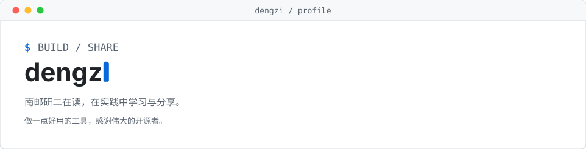

<picture>
  <source media="(prefers-color-scheme: dark)" srcset="./assets/hero-dark.svg">
  
</picture>

<!-- CONTRIB:BEGIN -->
<picture>
  <source media="(prefers-color-scheme: dark)" srcset="./assets/contrib-dark.svg?v=6f8fa228ea07">
  
</picture>
<!-- CONTRIB:END -->

## 代表作品

- **[deepseek-quotalk](<https://github.com/Dengzi555/deepseek-quotalk>)**：DeepSeek 网页划词追问扩展，结合上下文在浮动小窗中追问，支持流式回答与明暗主题。
- **[dsh-quotalk](<https://github.com/Dengzi555/dsh-quotalk>)**：DeepSeek Harness 桌面端划词追问，在原生侧边栏中解释文字与代码。
- **[花迹](https://github.com/Dengzi555/huaji-flower-agent)**：鲜花门店经营调查 Agent，从风险预警发起调查，生成结案报告和整改审批草稿。
- **[医点通](https://github.com/Dengzi555/zhiheng-medical-agent)**：基于 LangGraph 的中文健康资料助手，检索资料、校验原文引用，并提示证据不足或冲突。

统计口径与更新记录

统计本人创建、已经合并且公开的PR，排除Dengzi555账号名下仓库。每个展示仓库的PR数量单独核实，星标数取自更新时的公开API快照。

每天北京时间约09:17自动刷新，也可手动运行。定时任务可能延迟，获取或检查失败时保留上次结果。

[查看公开已合并PR](https://github.com/pulls?q=is%3Apr+is%3Amerged+is%3Apublic+author%3ADengzi555+-user%3ADengzi555) · [查看更新记录](https://github.com/Dengzi555/Dengzi555/actions/workflows/update-stats.yml)

Profile generated with [github-profile-polish](https://github.com/shi-felix/skills/tree/main/github-profile-polish). [素材来源](THEME-SOURCES.md)
