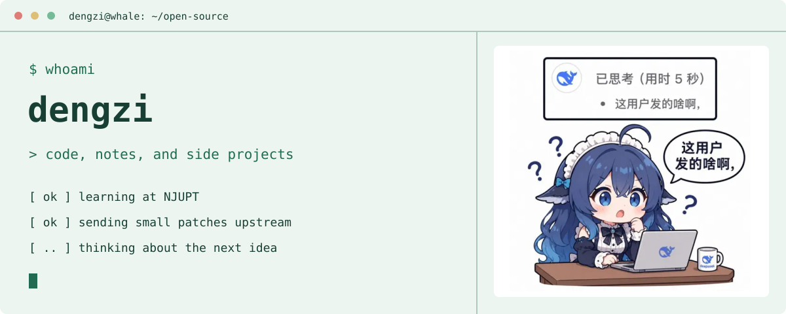
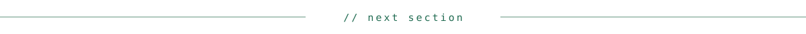
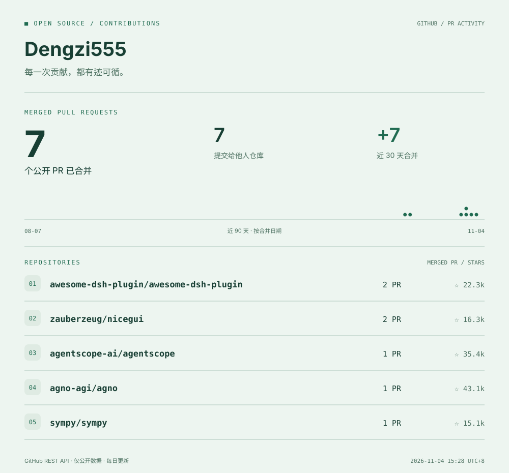

<picture>
  <source media="(prefers-color-scheme: dark)" srcset="assets/terminal/hero-dark.svg">
  
</picture>

### about

- 南邮研二在读，在实践中学习与分享。
- 正在做 DeepSeek 划词追问工具，持续参与开源。
- 感谢伟大的开源者。

<picture>
  <source media="(prefers-color-scheme: dark)" srcset="assets/terminal/divider-dark.svg">
  
</picture>

### projects

- **[deepseek-quotalk](https://github.com/Dengzi555/deepseek-quotalk)**：DeepSeek 网页划词追问扩展，结合上下文在浮动小窗中追问；支持流式回答、明暗主题，无需 API Key。
- **[dsh-quotalk](https://github.com/Dengzi555/dsh-quotalk)**：DeepSeek Harness 桌面端划词追问，在原生侧边栏中解释文字与代码。

<picture>
  <source media="(prefers-color-scheme: dark)" srcset="assets/terminal/divider-dark.svg">
  
</picture>

## 公开贡献

<picture>
  <source media="(prefers-color-scheme: dark)" srcset="assets/pr-stats-dark.svg">
  
</picture>

<a href="https://github.com/pulls?q=is%3Apr+author%3ADengzi555+is%3Amerged+is%3Apublic">查看已合并 PR ↗</a> · <a href="https://github.com/Dengzi555/Dengzi555/actions/workflows/update-stats.yml">更新记录 ↗</a>

统计口径

仅统计本人创建、已合并的公开 PR；向他人仓库的贡献单独计数，私有仓库不纳入统计。
时间按北京时间计算。时间线展示近90个自然日，近30天指标包含今天。
仓库按已合并 PR 数量排序，星标数是更新时的快照。

每天北京时间约09:17自动更新，也可在 Actions 中手动运行。定时任务可能延迟；图中标注实际成功更新时间。更新失败保留上次结果。

生成器：[`scripts/generate_stats.py`](https://github.com/Dengzi555/Dengzi555/blob/main/scripts/generate_stats.py) · 数据：[`stats.json`](https://github.com/Dengzi555/Dengzi555/blob/main/stats.json)

<picture>
  <source media="(prefers-color-scheme: dark)" srcset="assets/terminal/footer-dark.svg">
  
</picture>

Theme: Whale Terminal · Adapted from [github-profile-themes](https://github.com/Theater-ahyeon/github-profile-themes) · [素材来源](THEME-SOURCES.md)
